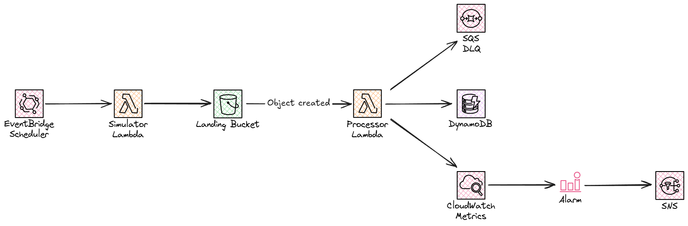

# linewatch

linewatch is a small serverless factory telemetry pipeline. A scheduled simulator writes CSV batches of production-line readings (temperature, cycle time, reject rate) to an S3 landing bucket. A processor validates the readings, stores them in DynamoDB and emits per-line metrics, and CloudWatch alarms notify the line's owner through SNS.



The codebase grows along four largely independent axes:

- **Expression.** One description produces many resources, through `for_each`, `dynamic` blocks, `for` expressions, type constraints and validation.
- **Composition.** The configuration splits into versioned modules and several root stacks, and is deployed to more than one environment and Region.
- **Lifecycle.** Closing the gap between configuration and reality: importing, detecting drift, renaming without destroying, and controlling what happens at destroy time.
- **Governance.** Proving a change is safe before it lands, with tests, policy as code, a pipeline without long-lived credentials, and secrets kept out of state.

Every service stays within the AWS free tier. The cost rules are enforced in code where possible: provisioned DynamoDB capacity, at most 10 alarms and 10 custom metrics, and no NAT gateways, EC2, RDS, customer-managed KMS keys or Secrets Manager.

## Requirements

- [mise](https://mise.jdx.dev), which installs the Terraform version pinned in `mise.toml`. Any Terraform `~> 1.16` also works.
- AWS CLI v2, signed in to the target account with permission to manage S3, DynamoDB, SNS and Budgets.
- An email address for the budget and alert notifications.

## Folder structure

```text
linewatch/
├── .github/
│   ├── workflows/         # reusable validate → plan → apply workflow
│   └── dependabot.yml     # weekly updates for actions and the AWS provider
├── live/                  # root modules: one directory = one state file
│   ├── account/           # account-wide singletons: state bucket, budget
│   └── dev/
│       └── ingest/        # alerts topic, landing bucket, readings table
└── mise.toml              # pinned Terraform; `mise run check` runs the CI format and validation checks
```

Every root module has the same scaffolding: `terraform.tf`, `backend.tf`, `env/<region>.s3.tfbackend`, `providers.tf` and a committed `.terraform.lock.hcl`. Variables without defaults, such as notification emails, go in a gitignored `terraform.tfvars`.  Each stack's `terraform.tfvars.example` shows what to fill in.

## Usage

### Check

Run the same format and validation checks as CI. They need no AWS credentials:

```sh
mise trust
mise install
mise run check
```

### Deploy

Apply the stacks in order, `live/account` first, so the budget exists before anything billable. For each stack:

```sh
cd live/<stack>
cp terraform.tfvars.example terraform.tfvars   # fill in the email
terraform init -backend-config=env/eu-central-1.s3.tfbackend -lockfile=readonly
terraform plan -out=tfplan
terraform apply tfplan
```

Read the plan before applying it. Applying the saved `tfplan` applies exactly what was reviewed, and Terraform refuses it if the state has changed since. `init` is only needed the first time and after provider changes.

After the first apply of `live/dev/ingest`, accept the SNS subscription email. Alerts are not delivered until the subscription is confirmed.

### First-time bootstrap

In a new account the state bucket doesn't exist yet, so `live/account` has to create it with local state first and then move its state into it:

```sh
cd live/account
printf 'terraform {\n  backend "local" {}\n}\n' > backend_override.tf   # gitignored
terraform init
terraform apply
terraform output -raw backend_config > env/eu-central-1.s3.tfbackend
rm backend_override.tf
terraform init -migrate-state -backend-config=env/eu-central-1.s3.tfbackend
```

Once the state is in the bucket, delete the local `terraform.tfstate`. Then update the `bucket` line in every other stack's `env/eu-central-1.s3.tfbackend` to the new bucket name.

## State layout

Each directory under `live/` is one root module with its own state file. Every state file lives in the same S3 bucket, which `live/account` manages, and the stacks differ only in the `key` line of `env/<region>.s3.tfbackend`:

| Stack | State key | Holds |
|---|---|---|
| `live/account` | `linewatch/account/terraform.tfstate` | account-wide singletons: state bucket, budget |
| `live/dev/ingest` | `linewatch/dev/ingest/terraform.tfstate` | the dev pipeline: SNS, S3 landing bucket, DynamoDB |

A single state file would be simpler. Separate files were chosen anyway, for these reasons:

- **Blast radius.** A plan only touches what is in its own state. A mistake in a dev stack cannot replace or delete the state bucket, the budget or, later, the deploy roles.
- **Different lifecycles.** The account stack rarely changes, and the state bucket has `prevent_destroy`. Dev stacks churn and can be destroyed completely without touching it.
- **Singletons stay single.** The budget and the GitHub OIDC provider exist once per account. When prod arrives as `live/prod/*`, it copies the dev stacks without duplicating them or depending on dev.
- **Scoped permissions.** Each environment's deploy role can be limited to its own `linewatch/<env>/*` keys. With one state file, the dev pipeline would need write access to the state holding its own IAM role.
- **Independent locks and faster plans.** `use_lockfile` locks per key, and CI serialises runs per `working_directory`. A dev apply never blocks an account change, and each plan refreshes only its own resources.

What it costs:

- Every stack repeats the same few scaffolding files.
- Stacks cannot reference each other's resources directly. Values have to cross through `terraform_remote_state` or SSM parameters.
- You have to apply stacks in order yourself: `live/account` first.
