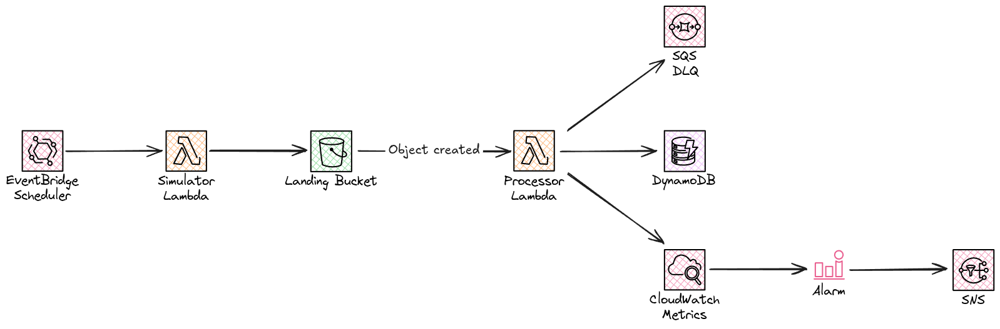

# linewatch

linewatch is a small serverless factory telemetry pipeline. A scheduled simulator writes CSV batches of production-line readings (temperature, cycle time, reject rate) to an S3 landing bucket. A processor validates the readings, stores them in DynamoDB and emits per-line metrics, and CloudWatch alarms notify the line's owner through SNS.



The codebase grows along four largely independent axes:

- **Expression.** One description produces many resources, through `for_each`, `dynamic` blocks, `for` expressions, type constraints and validation.
- **Composition.** The configuration splits into versioned modules and several root stacks, and is deployed to more than one environment and Region.
- **Lifecycle.** Closing the gap between configuration and reality: importing, detecting drift, renaming without destroying, and controlling what happens at destroy time.
- **Governance.** Proving a change is safe before it lands, with tests, policy as code, a pipeline without long-lived credentials, and secrets kept out of state.

Every service stays within the AWS free tier. The cost rules are enforced in code where possible: provisioned DynamoDB capacity, at most 10 alarms and 10 custom metrics, and no NAT gateways, EC2, RDS, customer-managed KMS keys or Secrets Manager.

## Requirements

- [mise](https://mise.jdx.dev), which installs the Terraform version pinned in `mise.toml`. Any Terraform `~> 1.16` also works.
- AWS CLI v2, signed in to the target account with permission to manage S3, DynamoDB, SNS and Budgets.
- An email address for the budget and alert notifications.

## Folder structure

```text
linewatch/
├── .github/
│   ├── workflows/         # reusable validate → plan → apply workflow
│   └── dependabot.yml     # weekly updates for actions and the AWS provider
├── live/                  # root modules: one directory = one state file
│   ├── account/           # account-wide singletons: state bucket, budget
│   └── dev/
│       ├── ingest/        # the dev pipeline and its line monitoring, from the ingest and monitoring modules
│       └── studies/       # studies bucket and a data workspace per study
├── modules/               # shared modules, versioned with git tags
│   ├── ingest/            # landing bucket, readings table, dead-letter queue, Lambda functions and their Go source
│   ├── monitoring/        # alerts topic, line alarms and dashboard
│   └── data-workspace/    # one study's IAM role, scoped to its S3 prefix
└── mise.toml              # pinned Terraform; `mise run check` runs the CI format and validation checks
```

Every root module has the same scaffolding: `terraform.tf`, `backend.tf`, `env/<region>.s3.tfbackend`, `providers.tf` and a committed `.terraform.lock.hcl`. Variables without defaults, such as notification emails, go in a gitignored `terraform.tfvars`.  Each stack's `terraform.tfvars.example` shows what to fill in.

## Usage

### First-time bootstrap

In a new account the state bucket doesn't exist yet, so `live/account` has to create it with local state first and then move its state into it:

```sh
cd live/account
printf 'terraform {\n  backend "local" {}\n}\n' > backend_override.tf   # gitignored
terraform init
terraform apply
terraform output -raw backend_config > env/eu-central-1.s3.tfbackend
rm backend_override.tf
terraform init -migrate-state -backend-config=env/eu-central-1.s3.tfbackend
```

Once the state is in the bucket, delete the local `terraform.tfstate`. Then update the `bucket` line in every other stack's `env/eu-central-1.s3.tfbackend` to the new bucket name.

### Check

Run the same format and validation checks as CI, for every stack and every module. They need no AWS credentials, but `live/dev/studies` downloads its module from GitHub:

```sh
mise trust
mise install
mise run check
```

### Deploy

Apply the stacks in order, `live/account` first, so the budget exists before anything billable. For each stack:

```sh
cd live/<stack>
cp terraform.tfvars.example terraform.tfvars   # fill in the emails or analyst ARNs
terraform init -backend-config=env/eu-central-1.s3.tfbackend -lockfile=readonly
terraform plan -out=tfplan
terraform apply tfplan
```

Read the plan before applying it. Applying the saved `tfplan` applies exactly what was reviewed, and Terraform refuses it if the state has changed since. `init` is only needed the first time and after provider changes.

After the first apply of `live/dev/ingest`, accept the SNS subscription email. Alerts are not delivered until the subscription is confirmed.

### Monitoring

Production lines are described once, in the `lines` variable of `live/dev/ingest`. The simulator writes readings for every line, and each line's thresholds generate its monitoring:

- One metric filter per threshold turns the processor's JSON log lines into a `linewatch/dev` metric with a `line_id` dimension.
- One alarm per line watches its worst metric as a fraction of that metric's limit. It notifies the alerts topic and, if set, the line's `owner_email` on a topic of its own. A `critical` line alarms on the first batch out of spec and reports recovery. A `standard` line alarms on the second batch in a row.
- A dashboard graphs each metric against the lines' limits. `terraform output dashboard_url` prints its address.

The free tier covers 10 custom metrics and 10 alarm metrics per account. Every threshold uses one of each, because an alarm on three metrics is billed as three alarm metrics. A validation fails the plan above 10 thresholds. Lines without thresholds cost nothing.

To change the lines, set `lines` in `terraform.tfvars`, as `terraform.tfvars.example` shows. It replaces the whole default map. Each new owner gets a subscription email to accept.

To see an alarm fire, lower a limit below what the simulator produces, such as `temperature_c = 60`, apply, and invoke the simulator instead of waiting for the next batch:

```sh
aws lambda invoke --function-name "$(terraform output -raw simulator_function_name)" /dev/null
```

To test only the notifications:

```sh
aws cloudwatch set-alarm-state --alarm-name linewatch-dev-line-1-out-of-spec \
  --state-value ALARM --state-reason "Testing notifications"
```

The line resources use `for_each`, so Terraform tracks each one by name, such as `reading["line-2/reject_rate"]`. With `count` it would track them by number instead: `reading[0]`, `reading[1]`, and so on. Removing `line-1` would then renumber every filter after it, and the plan would show changes to line-2 and line-3 even though only line-1 was removed. With `for_each`, the plan only removes line-1's filters.

### Studies

`live/dev/studies` gives each study an isolated workspace in one shared studies bucket. Each study in the `studies` variable gets:

- The `studies/<study_id>/` prefix of the bucket.
- An IAM role, `linewatch-dev-study-<study_id>`, that can list, read, write and delete objects only under that prefix.
- `Study` and `DataClassification` tags on the role. The classification is `public`, `internal`, `confidential` or `restricted`.

Analysts are existing IAM users or roles, named once in `analysts`. A study's role trusts the study's own `analysts` and every name in `lead_analysts`. `terraform output access_matrix` shows who can assume each study's role. IAM checks that a trusted ARN exists only at apply time, so a mistyped ARN plans fine and then fails to apply.

The studies stack keeps its own state, so onboarding a study never plans against the pipeline. To add a study, add it to `studies` in `terraform.tfvars` and apply. The plan adds only that study's role and policy.

To work in a study's workspace, add a profile that assumes its role, with the ARN from `terraform output study_role_arns`:

```ini
# ~/.aws/config
[profile trial-001]
role_arn       = arn:aws:iam::<account-id>:role/linewatch-dev-study-trial-001
source_profile = <your profile>
```

```sh
aws s3 cp results.csv "s3://$(terraform output -raw studies_bucket_name)/studies/trial-001/" --profile trial-001
```

List with the trailing slash, as in `studies/trial-001/`. Without it, S3 denies the request.

## Modules

The stacks share code through the modules in `modules/`. A module has no provider or backend blocks and sets only minimum versions (`>=`). The stack that calls it pins the exact versions in its own lock file.

`live/dev/ingest` calls its modules by local path, so dev always runs the code in the working tree. `live/dev/studies` downloads `data-workspace` from GitHub at a tag:

```hcl
source = "git::https://github.com/borisdvlpr/linewatch.git//modules/data-workspace?ref=${var.data_workspace_ref}"
```

`data_workspace_ref` is a `const` variable, because `terraform init` reads it to download the module. Changing it needs another `init`. Until then, the plan fails with "Module source has changed". A change to the module reaches the studies stack only when this tag is bumped.

### Releasing a module version

Each module has its own versions, tagged `modules/<module>/v<major>.<minor>.<patch>`:

- **Patch:** a fix with no interface change.
- **Minor:** new inputs or outputs. Existing callers keep working.
- **Major:** an input or output is removed or changes meaning.

```sh
git tag -a modules/data-workspace/v2.1.0 -m "data-workspace module v2.1.0"
git push origin modules/data-workspace/v2.1.0
```

Push the tag before a stack refers to it. `init` clones from GitHub, and fails on a tag that exists only locally.

### Changing a module's interface

Rename or remove an input or output over two releases, so no caller breaks without a warning first:

1. In a minor release, add the new name, keep accepting the old one, and mark the old one `deprecated`. A caller that still uses it gets a warning naming the replacement. `data-workspace` v1.1.0 did this for `classification` → `data_classification` and `prefix` → `s3_uri`.
2. Move every caller to the new name, so it plans without warnings.
3. In the next major release, remove the old name, as `data-workspace` v2.0.0 did.

Terraform refuses `deprecated` on an output of the root module. A module with a deprecated output therefore fails `mise run check`, which validates each module on its own, until the major release removes that output. Warnings for a deprecated output show at `plan`, but not at `validate` when the module uses `for_each`.

### Moving resources into a module

The pipeline and its monitoring moved from `live/dev/ingest` into `modules/ingest` and `modules/monitoring` without being replaced. The stack declared one `moved` block per resource, from the old address to `module.<name>.<address>`. The plan showed only moves, and once they were applied, the blocks were removed.

## State layout

Each directory under `live/` is one root module with its own state file. Every state file lives in the same S3 bucket, which `live/account` manages, and the stacks differ only in the `key` line of `env/<region>.s3.tfbackend`:

| Stack | State key | Holds |
|---|---|---|
| `live/account` | `linewatch/account/terraform.tfstate` | account-wide singletons: state bucket, budget |
| `live/dev/ingest` | `linewatch/dev/ingest/terraform.tfstate` | the dev pipeline: SNS, S3 landing bucket, DynamoDB, CloudWatch alarms and dashboard |
| `live/dev/studies` | `linewatch/dev/studies/terraform.tfstate` | the studies bucket and each study's IAM role |

A single state file would be simpler. Separate files were chosen anyway, for these reasons:

- **Blast radius.** A plan only touches what is in its own state. A mistake in a dev stack cannot replace or delete the state bucket, the budget or, later, the deploy roles.
- **Different lifecycles.** The account stack rarely changes, and the state bucket has `prevent_destroy`. Dev stacks churn and can be destroyed completely without touching it.
- **Singletons stay single.** The budget and the GitHub OIDC provider exist once per account. When prod arrives as `live/prod/*`, it copies the dev stacks without duplicating them or depending on dev.
- **Scoped permissions.** Each environment's deploy role can be limited to its own `linewatch/<env>/*` keys. With one state file, the dev pipeline would need write access to the state holding its own IAM role.
- **Independent locks and faster plans.** `use_lockfile` locks per key, and CI serialises runs per `working_directory`. A dev apply never blocks an account change, and each plan refreshes only its own resources.

What it costs:

- Every stack repeats the same few scaffolding files.
- Stacks cannot reference each other's resources directly. Values have to cross through `terraform_remote_state` or SSM parameters.
- You have to apply stacks in order yourself: `live/account` first.
